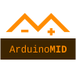

# ArduinoMid

Vauxhall/Opel **Astra G** & **Frontera** MID (Multi-Info Display) replacement on **Arduino Mega 2560**.  
Rebuild of the on-board computer using the original vehicle interface connector and a custom PCB.


# [Reference Manual / Homepage](https://github.com/fire1/ArduinoMid/wiki)

## Official managing application

[](https://play.google.com/store/apps/details?id=eu.fire1.arduinomid)

## Features (overview)

* Drop-in MID plug connection (see wiki and `resources/PCB/`)
* Graphical **240×64** T6963 LCD via U8g2 (16×2 LCD path still present, deprecated)
* Trip computer: speed, RPM, fuel, distance, temps, warnings
* Optional LPG support (serial switch / mixed consumption)
* Steering-wheel controls → aftermarket radio (digipot profiles)
* Multi-language UI (BG, EN, DE, HR, RU, SR, TR, LT)
* Android companion app for monitoring / management

## Quick start

1. Install required libraries from the `libraries/` folder (zip each library and import via Arduino IDE, or see `libraries/README.md`).
2. Open **`MID/MID.ino`** in the Arduino IDE.
3. Set board to **Arduino Mega 2560**.
4. Edit **`MID/conf.h`** for your car (language, radio, LPG, corrections). Leave platform defaults in `MID.h` unless you know you need them.
5. Upload the sketch.

Prebuilt hex dumps (if useful): `compiled/MID.ino.hex`.

## Configuration

Configuration is split across two files:

| File | Role |
|------|------|
| **`MID/conf.h`** | Your custom / vehicle settings — **edit this** |
| **`MID/MID.h`** | Platform defaults (pins, screen size, serial, debug) |

Typical `conf.h` choices:

* **Language** — enable exactly one `LANG_*` define
* **Radio** — `WHL_RDO_XPLOD` or `WHL_RDO_KDX330`
* **Fuel / LPG** — `DEFAULT_FUEL_USING`, `ADT_FUEL_SYSTEM_SERIAL`, optional `LPG_INSTALLATION` / switch pin
* **Vehicle** — engine power, weight, HP, logo, optional clock module, DRL pins
* Optional correction blocks (`CAR_SENS_CUSTOM_CORRECTION`, fuels, gears) when uncommented

Before uploading, skim `MID.h` so `SCREEN`, baud rate, and pin map match your hardware.

## Project layout

| Path | Contents |
|------|----------|
| `MID/` | Firmware source (`MID.ino` entry point) |
| `MID/lib/` | Sensors, EEPROM, menu, LPG, shutdown, services |
| `MID/lib/ui/` | LCD UI, menus, fonts, graphics, language packs |
| `libraries/` | Dependent Arduino libraries (as zip archives) |
| `tests/` | Standalone hardware / protocol sketches (LPG, display, melody, …) |
| `unit_tests/` | Host-side Catch2 unit tests for pure math / timing / LPG bits |
| `MID/lib/core/` | AVR-free helpers shared by firmware and unit tests |
| `resources/` | PCB docs/PDFs, Gerber, icons, 3D holders |
| `compiled/` | Precompiled firmware hex |
| `cmake/` | Optional CMake / CLion toolchain (paths may need local edits) |

For AI / contributor agent notes, see [`AGENTS.md`](AGENTS.md).

## Unit tests

Host-side tests (no Arduino board required) cover shared logic in `MID/lib/core/` plus `AmpTime` with a fake clock:

```bash
cmake -S unit_tests -B unit_tests/build
cmake --build unit_tests/build
ctest --test-dir unit_tests/build --output-on-failure
```

Hardware bring-up sketches remain under `tests/`.

## Hardware notes

* Target MCU: **ATmega2560** @ 16 MHz (Arduino Mega 2560)
* Custom PCB Gerber: `resources/gerber/MID_PCB_V1.4.5.zip`
* PCB drawings: `resources/PCB/`
* Display backlight variants (5V BuyDisplay vs 12V OptRex) are documented in `MID.h` pin comments

## Notes

* DO NOT CONTACT me to ask any question for a "Raspberry Pi" version!
* News: [Twitter](https://twitter.com/hashtag/ArduinoMid?src=hash) · [Facebook](https://www.facebook.com/search/top/?q=%23arduinomid)
* Full documentation and wiring: [wiki](https://github.com/fire1/ArduinoMid/wiki)

## Version

**1.6** — should be considered **beta** (test) quality. Trip-computer calibration is vehicle-specific.

## Donations

Every cent will be used for new features.  
Keep in mind I spend a lot of money and time on this project...

### [Donate!](https://paypal.me/AngelZaprianov)

---------------------------------

[](https://github.com/fire1/ArduinoMid)
